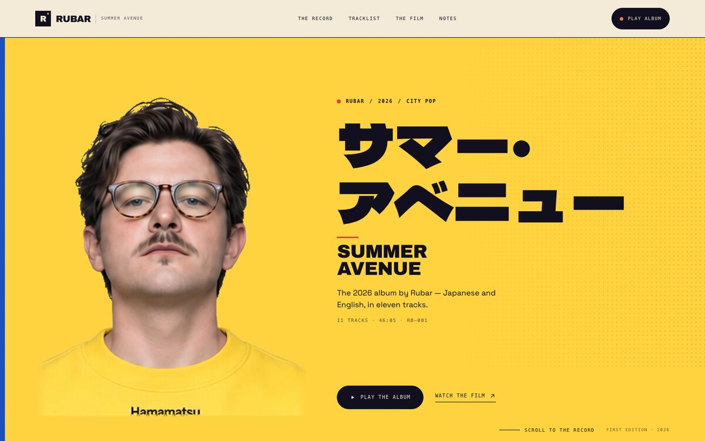
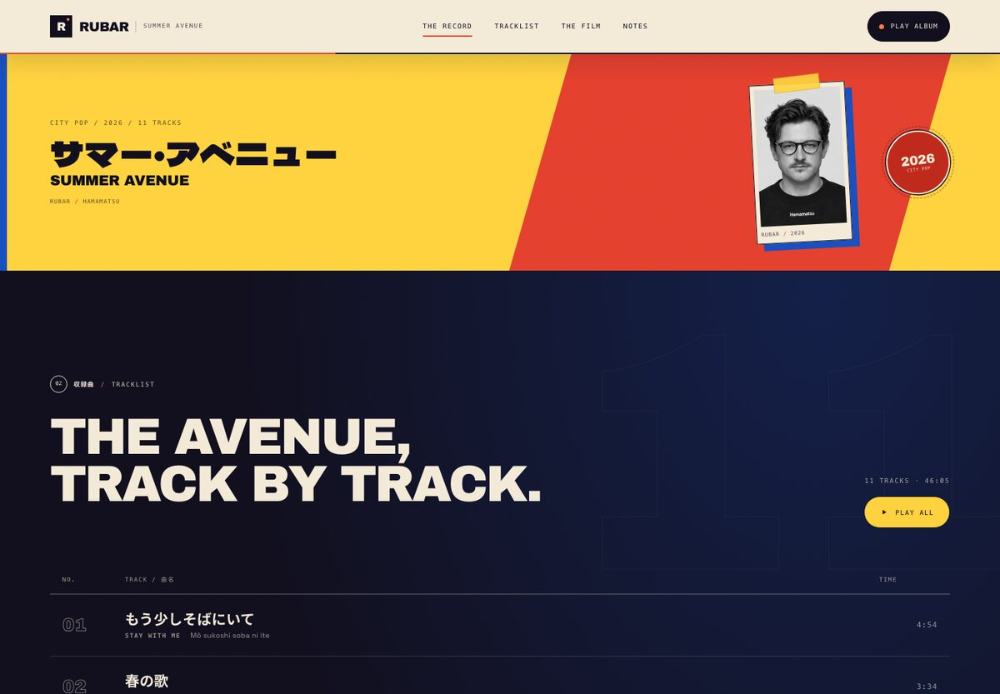
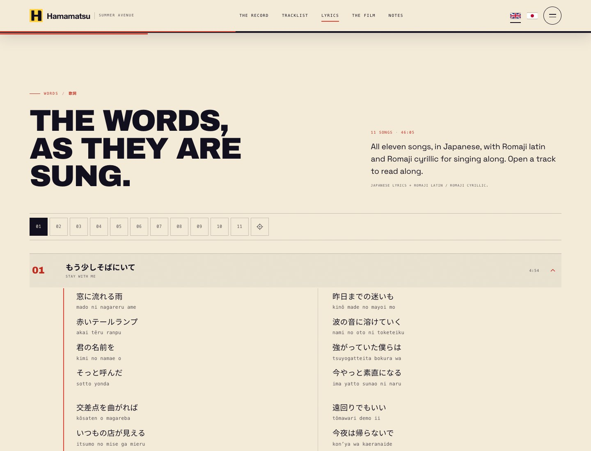
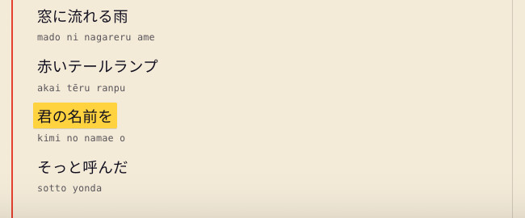
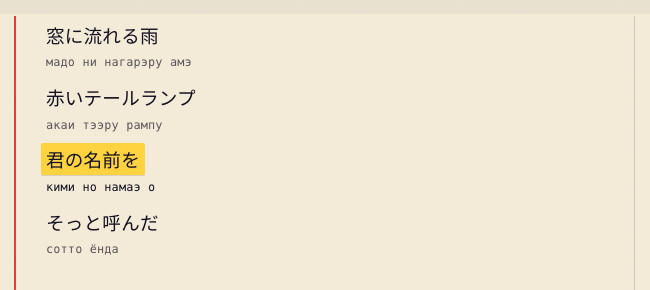
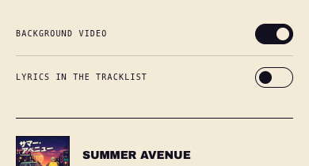
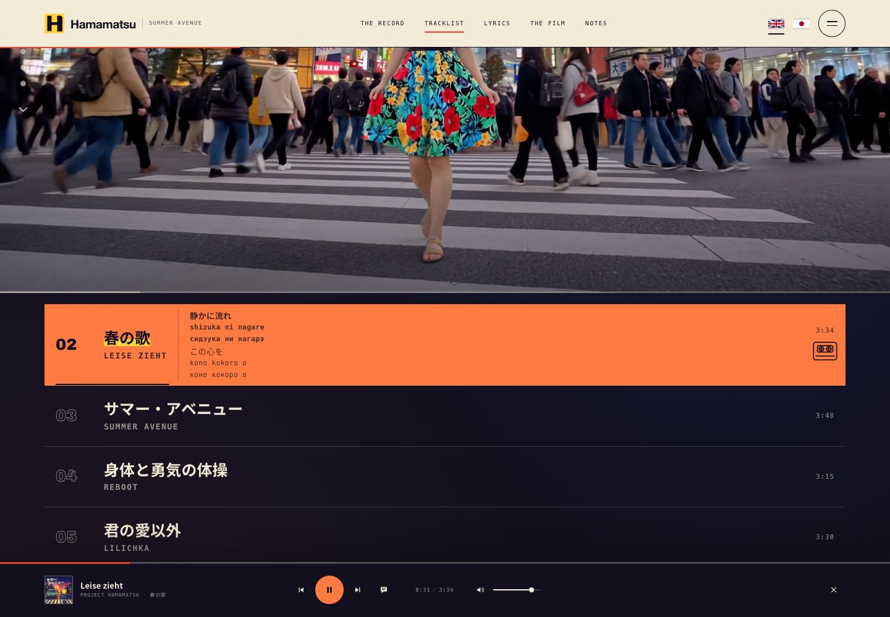

<div align="center">

# SUMMER AVENUE

**The 2026 album from Project Hamamatsu**

サマー・アベニュー · 11 tracks · 46:05 · Japanese / English

**[▶ Listen to the album](https://rbaranov.ch/hamamatsu)**

</div>

[](https://rbaranov.ch/hamamatsu)

[Desktop](docs/preview-desktop.jpg) · [Mobile](docs/preview-mobile.jpg) · [Tablet](docs/hero-tablet.jpg)

## The record

The official album site streams the full record in order, with a custom player, a 30-second film, the story behind the record, and the full Japanese lyrics of every song. Eleven city-pop songs for the long way home. A **Halloween Remix** single sits outside the album at [/hamamatsu/halloween](https://rbaranov.ch/hamamatsu/halloween), reached from the **Halloween** button in the album hero.

| # | 日本語 | English | Time |
|---:|---|---|---:|
| 01 | もう少しそばにいて | Stay With Me | 4:54 |
| 02 | 春の歌 | Leise zieht | 3:34 |
| 03 | サマー・アベニュー | Summer Avenue | 3:48 |
| 04 | 身体と勇気の体操 | Reboot | 3:15 |
| 05 | 君の愛以外 | Lilichka | 3:30 |
| 06 | 遠くで | Arigato | 3:32 |
| 07 | アナスタシア | Anastasia | 3:50 |
| 08 | 風に乗せたメッセージ | Crossing Into Tomorrow | 4:53 |
| 09 | シャガネ、愛しいシャガネ | Shagane | 4:14 |
| 10 | 海へ行こう | June Ease | 5:04 |
| 11 | 今夜だけはさよならを言わないで | Blue Tile Reflections | 5:30 |

**Runtime:** 46:05 · **Catalogue:** RB–001 · **Year:** 2026

## The Halloween single

**Summer Avenue (Halloween Remix)** is a one-off single, released outside the album. It has its own dark page at **[/hamamatsu/halloween](https://rbaranov.ch/hamamatsu/halloween)**, reached from the **Halloween** button in the album hero; the single page links back to the album and the album footer links to the single.

- **Audio:** `assets/audio/singles/01-summer-avenue-halloween-remix.mp3` — 320 kbps MP3, 48 kHz stereo, 211.96 s (**3:32**).
- **Player:** one track and one source, with no queue and no auto-advance. Play/pause, seek, mute/volume (remembered in `sa-volume`), Media Session metadata and position state, and a vinyl disc that turns only while playing. A click or tap on the vinyl itself toggles playback. The readout is not a card: it is set directly into the poster, with only a hairline and the type for structure. A 132 BPM procedural oscilloscope trace pulses under the controls while playing, twitching wider on each beat and settling to a flat line when paused.
- **Route:** `halloween/index.html` is served at `/hamamatsu/halloween`. The build copies the directory to `dist/halloween/`, and `vercel.json` maps both the clean and trailing-slash URLs to `/halloween/index.html`.
- **Release sheet:** below the hero, a cover, the single's credits (format, catalog RB–002, runtime, source album) and links to the album and its lyrics.
- **Share:** the **Share the page** action shares the canonical `/hamamatsu/halloween` URL and, where the browser's Web Share implementation supports files, attaches the 1254 px release cover as a JPEG. The cover is prefetched at load and on hover/focus so the native sheet opens immediately; the link is included in the share text as well as the URL field. If a target rejects the URL field alongside files, the share retries with the file and text. Browsers without file sharing fall back to a link-only share, and browsers without native sharing copy the link; standard toasts. Playback lives in the player: the vinyl disc itself and the play button both toggle it; there is no separate hero play/pause button.
- **Artwork:** the cover is generated from `tools/halloween-cover.html` at 1254, 800 and 512 px; the social card is generated from `tools/halloween-og.html`.

## Stack

A deliberately simple static site — no framework, no bundler, no build step, and two vendored runtime libraries.

- **HTML5** with semantic landmarks, ARIA, `MusicAlbum` JSON-LD on the album and `MusicRecording` JSON-LD on the Halloween single.
- **CSS3** with custom properties, Grid/Flexbox, fluid typography, and no dependencies; `halloween.css` is the dark night-edition layer over the same design system.
- **Vanilla JavaScript** for the custom audio player, film player, mobile menu, reveals, share action, the lyrics highlight, one-shot jump, and romaji/Cyrillic controls, plus the single-track player on the Halloween page.
- **i18n:** **i18next 26** (vendored UMD build, MIT) for English and Japanese interface copy, metadata, ARIA labels, player/film states, and the header flag switcher. The library lives in `assets/js/vendor/`; no package install is required.
- **Storage:** **store2 2.14.4** (vendored UMD build, MIT) for the selected language (`sa-lang`), the background-video preference (`sa-videos`), the Romaji latin preference (`sa-lyrics-romaji`), the Romaji cyrillic preference (`sa-lyrics-cyrillic`), and the inline tracklist readout (`sa-track-lyrics`). The library lives in `assets/js/vendor/`; no package install is required.
- **Audio:** native `HTMLAudioElement` + **Media Session API**; full-album stream, seek, next/previous, volume, auto-advance. The Halloween page uses the same primitives for one source, with no queue and no auto-advance.
- **Video:** native HTML5 video with custom controls, a poster, and a non-interactive full-width progress bar on the background tracklist clips; the menu's **Background video** switch shows or hides those clips while tracks play.
- **Lyrics:** static HTML `<details>` disclosures with timed `.lyric-line` spans in `index.html`; no runtime data fetch for the text, so the lyrics are available without JavaScript, are indexable, and expand for print. When the player is running, the open song highlights its current line, and the one-shot icon-only **Follow the lyrics** button in the page-number index opens the active song at its current line. The player's lyrics button uses the same jump. The menu's **Lyrics in the tracklist** switch adds a compact current/next readout inside the active track row. Each Japanese line can be paired with **Romaji latin** and/or **Romaji cyrillic**; the two menu switches control both the full lyrics and the active row's current- and next-line transliteration.
- **Fonts:** Archivo Black, Dela Gothic One, Space Grotesk, Noto Sans JP (Google Fonts).
- **Hosting:** Vercel, deployed from the `main` branch of `rouslanbaranov/hamamatsu`.
- **QA:** Playwright + Chromium; axe-core reports **0 WCAG A/AA violations** in both languages at desktop, mobile, playing, the one-shot lyrics jump, Romaji latin / Romaji cyrillic on/off, and open-menu states. The Halloween single page was checked at 390, 900, 901, 1024, 1280 and 1440 px, with playback, language switching and both breakpoints; axe-core reports **0 violations** in English and Japanese at desktop and mobile. The remaining incomplete checks are the contrast-over-grain/gradient-artwork heuristic there and on the album, and the approved film having no separate captions track.

No analytics, no cookies, no tracking. The only third-party request is Google Fonts.

## Visual system

The palette is documented in `assets/css/styles.css`:

- **Ink + cream** — paper and night surfaces, primary text.
- **Sunset orange** — the album's dusk and the primary playback action.
- **Editorial red** — the hero marker, active indicators, the interlude seal, the quote mark.
- **Paper yellow** — the hero field, printed labels, and tape.
- **Cobalt blue** — the film chapter, the hero's left edge, and the interlude's offset shadow.



The first screen is a split Japanese-release poster: saturated yellow behind the full-height portrait on the left, and a warm white-pink field with one large powder-pink circle behind the type on the right, joined by a subtle 7–10° diagonal. The supplied **black Hamamatsu hero portrait** (1024×1536) is fully contained and uncropped, with no card, sleeve, vinyl, or frame. The header uses the new geometric **H** mark and the supplied “Hamamatsu” wordmark in Helvetica Neue/Arial Bold, matching the tight neo-grotesque print on the shirt. A 24–32px desktop gutter keeps the Japanese title entirely on the rose field, and a live **’80s-style City Pop** accent in Sedgwick Ave Display sits immediately right of the English title, vertically centred on the two-line block with a 20–26px gutter, and wraps beneath it only when space is tight. The Japanese title is live HTML in Dela Gothic One (`lang="ja"`); the English title is the second level. The film player returns to its poster and **PLAY THE FILM** after a natural ending; a mid-film pause keeps its frame and position.

The **Halloween single** page is the night edition of the same poster. It keeps the split field, the diagonal seam, the Japanese/English title hierarchy, the cream type and the Sedgwick annotation; the cobalt edge becomes blood red, the paper becomes aubergine and pumpkin, and the portrait becomes a large, slowly turning vinyl. Where the sakura branch was, a bare branch crosses a full moon with bats and a cobweb; below it, a silhouetted city, jack-o'-lanterns and low fog carry the bottom of the page. The hero is the player: a large disc with an orange label, and — set directly into the poster, with no card, border or panel — a readout with the track number and title over a hairline, then a pumpkin play button, a thin seek line, the running time and a volume hairline; a 132 BPM oscilloscope trace pulses beneath the controls only while the track plays, with a large amplitude and a twitch on each beat. A black spider with a warm backlight crawls the cobweb in the top-left corner, and dry leaves detach from the top-right branch and are carried to the right by the wind. The release sheet below repeats the cover and the single's credits. The header, footer and focus rings are dark as well; the album page keeps its light poster.


[Mobile](docs/halloween-mobile.jpg) · [The single's release sheet](docs/halloween-single.jpg)

The Record shows the new official cover flat — the 1254×1254 artwork has no artist wordmark; a hairline border and plain metadata are the only framing. The interlude remains the single collage accent: one diagonal red plane, a blue edge, the Japanese title, and the top-left front face from the new **4-face Hamamatsu sheet**, cropped and converted to B&W, captioned `Hamamatsu / 2026`. The Notes media is now an original anime-style city avenue at dusk — a huge setting sun, overhead wires, neon shop signs, and no portrait.

The lyrics chapter is the booklet: cream paper, a red margin rule, a sticky 01–11 index, and two-column Japanese stanzas on wide screens; native disclosures keep one song open at a time. On mobile the index wraps to two rows and the stanzas run in a single column. The current line is marked with a yellow highlighter, and the icon-only **Follow the lyrics** button is a one-shot navigator: it opens the active track's song in the accordion and scrolls to the current line. It keeps no state and does not follow on its own. The page-number index wraps as needed so the icon is always visible, and the player's lyrics button performs the same jump. Each Japanese line can show a smaller **Romaji latin** and/or **Romaji cyrillic** transliteration for singing along. Both are switches in the hamburger menu, shown like the video and tracklist-lyrics preferences, and remembered in `sa-lyrics-romaji` / `sa-lyrics-cyrillic`; **Romaji latin** is on by default and **Romaji cyrillic** is off. The switches are always available because the full lyrics page uses them; the active track row shows the selected transliteration under both the current and the next Japanese line. The page-number index also contains the one-shot **Follow the lyrics** navigator.



[Mobile lyrics](docs/lyrics-mobile.jpg)





The hamburger menu now carries both display preferences at the bottom, above the black footer rule: **Background video** and **Lyrics in the tracklist**, each as a text label with a switch. The menu button is available at every width, so the switches stay reachable on desktop too; the top navigation hides while the panel is open.



The **Lyrics in the tracklist** switch turns on a compact readout inside the active track row: the current line in bold, its Romaji and Cyrillic in bold too, the next line muted, and the selected **Romaji latin** / **Romaji cyrillic** under both lines according to the menu switches. The title and lyrics share a `.track__main` container; the timer and cassette live separately in `.track__meta`. The title stays in full ink and gets a yellow marker underline, while the inline lyrics use a warm secondary brown so the title remains the focal point. On wide full-width rows the lyrics sit to the right of the title; on narrow rows and the wide-screen video stage they drop below the title, and the horizontal rule spans only the main column, never the timer/cassette column. The readout keeps three line groups in a clipped track: the current and next lines are visible, and the line after next is always present below but hidden. A line change scrolls the track by exactly one group over 500 ms with linear timing and no fade; the incoming line becomes current and bold as soon as the scroll starts, while the outgoing line loses its active styling immediately. `prefers-reduced-motion: reduce` switches lines instantly. The choice is remembered in `sa-track-lyrics`. The full lyrics section follows the same transliteration switches.



[Inline lyrics on mobile](docs/lyrics-inline-mobile.jpg)

## Project structure

```text
.
├── index.html
├── halloween/
│   └── index.html          # Summer Avenue (Halloween Remix) single page
├── assets/
│   ├── audio/              # 11 × 320 kbps MP3 album streams
│   │   └── singles/        # 01-summer-avenue-halloween-remix.mp3
│   ├── css/
│   │   ├── styles.css
│   │   └── halloween.css   # the dark night edition of the poster + player
│   ├── img/                # album cover, black hero portrait, Halloween cover/OG, skyline/branch SVG, icons
│   ├── js/
│   │   ├── i18n.js         # i18next setup + English/Japanese dictionaries
│   │   ├── main.js
│   │   ├── halloween.js    # one-track player + single page layer
│   │   ├── tracks-video.js
│   │   ├── lyrics.js       # lyrics accordion, deep links, highlight, romaji/Cyrillic, inline readout, one-shot jump
│   │   └── vendor/         # vendored i18next + store2 UMD builds with MIT licenses
│   └── video/              # 30s film, 720×1280 H.264
├── docs/                   # README previews + section screenshots
├── tools/
│   ├── og.html             # source for the album social preview
│   ├── halloween-cover.html # source for the single cover
│   └── halloween-og.html   # source for the single social card
├── vercel.json
├── scripts/build.mjs
├── site.webmanifest
├── robots.txt
├── sitemap.xml
└── .nojekyll
```

The repository intentionally includes the **320 kbps website masters** (106 MB). FLAC and WAV distribution masters are not committed; keep those in the mastering pipeline or a distributor package.

## Local development

```bash
# From the repository root
npx http-server -p 8765 -c-1 .
# then open http://127.0.0.1:8765/
```

The single page is `halloween/index.html`: with a plain root server it is at `http://127.0.0.1:8765/halloween/`; behind the production `/hamamatsu` mapping it is at `http://127.0.0.1:8765/hamamatsu/halloween`.

> Use a range-capable server for audio testing. Python's built-in `http.server` does not support HTTP Range requests, so **seeking** in the player may fail locally even though it works on GitHub Pages. `http-server` supports ranges.

### Social preview

The card is a 1200×600 capture of the homepage hero with the header hidden, the left blue edge removed, and the scroll/edition footer trimmed, `assets/img/og-summer-avenue-home-2026.jpg`, used for both `og:image` and `twitter:image`. Re-capture it at 1200×630 with reduced motion enabled when the hero changes. `tools/og.html` is the earlier hand-built card, kept for reference.

The Halloween single has its own 1200×630 card, `assets/img/og-summer-avenue-halloween-2026.jpg`, generated from `tools/halloween-og.html`, and its own cover art, `assets/img/cover-summer-avenue-halloween-{1254,800,512}.jpg`, generated from `tools/halloween-cover.html`. Re-render both artboards after changing the Halloween art; the page's `og:image` and the Media Session artwork point at those files.

Previews are cached per URL. After replacing the image, re-scrape with the Facebook Sharing Debugger or LinkedIn Post Inspector.

## Editing content

- **Track list:** the 11 `.track` elements in `index.html`. Each button carries `data-src` and `data-duration`; the Japanese title is `.track__ja`, the English title is `.track__en`, and the romanization is `.track__romaji`. Keep the JSON-LD block and durations in sync.
- **Lyrics:** the 11 `<details class="song">` blocks in the lyrics section of `index.html`. Each line is a `.lyric-line` span with `data-at` / `data-end` seconds; stanzas are `<p>` elements with `<br>` breaks. The `<summary>` carries the number, Japanese title, English title and duration, and must stay in sync with the tracklist. The Japanese text is content, not an i18n string. Section labels, production notes and vocal labels from the Suno source were removed; repeated choruses are printed every time. The timings come from Suno's aligned lyrics and include the repeated intro/outro lines. Each `.lyric-line` is followed by a `.lyric-romaji` span (`lang="ja-Latn"`) and a `.lyric-cyrillic` span (`lang="ru"`) with the transliterations; both are plain text after the Japanese line and are not part of the timing or highlight. There are 298 unique readings for the 442 line appearances. The romaji was generated with Janome and checked for particles, long vowels and compounds; the Cyrillic is a systematic transliteration of that reviewed romaji (long vowels doubled, `n` before b/p/m → м, sokuon doubled, sh/ch/ts and j/z handled). `assets/js/lyrics.js` handles the one-open-at-a-time accordion, `#lyrics-01` deep links (honoured on load, then removed from the URL; in-page opens no longer write a hash), the player shortcut, the current-line highlight, the always-available hamburger-menu **Romaji latin** and **Romaji cyrillic** switches (`sa-lyrics-romaji`, `sa-lyrics-cyrillic`), the current and next lines' selected transliterations in the active track row, the one-shot icon-only **Follow the lyrics** navigator in the page-number index that opens the active track's song and scrolls to its current line (no stored state; the index wraps so the button stays visible), and print expansion.
- **Copy and sections:** `index.html`; interface strings live in `assets/js/i18n.js` (see Localization below).
- **Halloween single page:** `halloween/index.html`; interface copy under `halloween.*` and page metadata under `meta.halloween.*` in `assets/js/i18n.js`; dark layout in `assets/css/halloween.css`; one-track player in `assets/js/halloween.js`. The audio is `assets/audio/singles/01-summer-avenue-halloween-remix.mp3` (3:32, RB–002); keep the `<audio>` source, the JSON-LD and the displayed runtime in sync. The cover and OG art are generated from `tools/halloween-cover.html` and `tools/halloween-og.html`; the vector scene is `assets/img/halloween-skyline.svg` and `halloween-branch.svg`.
- **Halloween links:** the **Halloween** button in the album hero actions (plus the mobile-only copy under the hero meta and the footer nav link) points to `/hamamatsu/halloween`. The single page's header **Album** pill and its hero back link point to `/hamamatsu`. The single is not part of the album tracklist or the album JSON-LD.
- **Palette, type, layout:** `assets/css/styles.css`; the Halloween night palette and player are in `assets/css/halloween.css`.
- **Player behaviour:** `assets/js/main.js`.
- **Cover / hero cutout / portrait / poster:** `assets/img/` — the hero uses `hero-portrait-black-full.png` with a `hero-portrait-black-full.webp` source and no crop; the collage uses the 660×470 `character-black-2026` crop. The full sheets are not shipped as web assets.
- **Film:** `assets/video/summer-avenue-film-30s.mp4`, with `assets/img/film-poster.jpg`.
- **Background video:** the tracklist film clips; the **Background video** switch at the bottom of the hamburger menu shows or hides them during playback. The preference is stored in `sa-videos` through store2.
- **Inline tracklist lyrics:** the **Lyrics in the tracklist** switch at the bottom of the hamburger menu shows the current and next line inside the active `.track` button. `assets/js/lyrics.js` injects the `.track__lyrics` readout, fills it from the timed `.lyric-line` data, adds the current and next lines' selected `.track__lyric--romaji` / `.track__lyric--cyrillic` readings, keeps three line groups in a clipped track (two visible, the next-next hidden), scrolls the track by one group with a 500 ms linear transition and no fade, promoting the incoming line to current/bold at the start of the scroll, and persists the choice as `sa-track-lyrics`. The readout is `aria-hidden` so the track button's accessible name stays stable; the **Romaji latin** / **Romaji cyrillic** switches decide which readings appear in both the row and the full lyrics. The active row wraps the title and lyrics in `.track__main` and keeps the timer/cassette in a separate `.track__meta`; the title remains full ink with a yellow marker underline and the lyrics use a warm secondary brown, the layout puts the lyrics beside the title on wide rows and below it on narrow rows and the wide-screen video stage, with the rule stopping at the main column.
- **Social links:** the three centred links at the bottom of the yellow outro (`.outro__social`) and the matching trio in the hero's bottom-left corner (`.hero-poster__social`) open LinkedIn at `https://www.linkedin.com/in/rbaranov/`, SoundCloud at `https://soundcloud.com/rouslan-baranov`, and the rbaranov.ch landing page (the RB favicon, redrawn monochrome).
- **Streaming / store links:** not wired yet. Add them to the outro section when the album is live on platforms. Release date is shown as **2026** only; update if a specific date is set.
- **Custom domain:** add a `CNAME`, then update the canonical URL, Open Graph image URL, sitemap, and robots sitemap line.

### Localization

The site ships with **English** and **Japanese** interface copy. The dictionaries are the `en` and `ja` objects at the top of `assets/js/i18n.js`; both must contain the same keys.

- **Static markup:** add `data-i18n="namespace.key"` for plain text, `data-i18n-html="namespace.key"` when the string contains markup such as `<br>` or separator spans, and `data-i18n-attr="aria-label:namespace.key; title:namespace.key"` for attributes.
- **Stateful UI:** strings set by JavaScript (player labels, document title, Media Session metadata, share payload, toasts, film controls, background-clip labels, single-player labels) call `t('namespace.key', { ... })` from `assets/js/main.js`, `assets/js/tracks-video.js` or `assets/js/halloween.js`. Language changes dispatch `i18n:changed`, and the scripts refresh their current-state labels.
- **Add a string:** add the key to both dictionaries, then either use one of the data attributes above or call `t()` from JavaScript.
- **Language selection:** `?lang=en|ja` wins, then the saved `sa-lang` choice (read through store2), then the first supported browser language. The header flags call `i18next.changeLanguage`, persist the choice, update the query string with `history.replaceState`, and refresh `<html lang>`, document metadata, alternate `og:locale`, ARIA labels, and image alt text.
- **Titles:** album and track titles are proper names, so the tracklist keeps both the Japanese title and its English alternate. The surrounding UI, metadata, and accessibility copy switch language.
- **Page-scoped metadata:** the Halloween page sets `data-page="halloween"` on `<html>`; `applyLanguageToDocument()` then reads `meta.halloween.*` for the document title, description, OG/Twitter copy and alt text, while the album keeps `meta.*`. The single UI lives under `halloween.*` in both dictionaries. The release title, the player's track name and the cover art are English proper names; the page also carries the Japanese title ハロウィーン.
- **Lyrics:** the lyrics are Japanese content and are not translated; the romaji and Cyrillic are readings, not translations. The interface around them lives under `lyrics.*` and `nav.lyrics` / `player.lyrics` in both dictionaries. The index links carry the Japanese and English titles as visually hidden `lang`-tagged text. The icon-only **Follow the lyrics** control uses the `lyrics.follow` string for its `aria-label` and title; it has no visible label and no pressed state. The transliteration switches use `menu.romajiLatin` / `menu.romajiCyrillic` inside the same group as `menu.video` / `menu.lyrics`, labelled by `menu.preferencesAria`; they have no state-dependent labels. The lead and note use the updated `lyrics.lead` / `lyrics.note`.

## Deployment

Every push to `main` deploys the site through **GitHub Actions → GitHub Pages** (`.github/workflows/pages.yml`).

In the repository settings, **Pages → Build and deployment → Source** must be **GitHub Actions**. The workflow uploads the repository root as the Pages artifact, then deploys it.

Live URL: **https://rbaranov.ch/hamamatsu**

The single is live at **https://rbaranov.ch/hamamatsu/halloween**. On Vercel, `scripts/build.mjs` copies `halloween/` into `dist/`, and `vercel.json` maps `/hamamatsu/halloween` and its trailing-slash form to `/halloween/index.html`; the generic `/hamamatsu/:path*` rewrite continues to serve the shared assets. The sitemap lists both pages.

## Accessibility

- Skip link, visible focus states, semantic landmarks, and labelled controls.
- The header language switcher uses two native buttons with `aria-pressed`, a localized group label, and inline SVG flags. Switching updates `<html lang>`, document metadata, alt text, and every ARIA label or live-region message.
- Full keyboard support for the player, film, menu, and all actions.
- `prefers-reduced-motion` disables the hero entrance, the interlude seal, and all reveals while keeping the full composition visible.
- One semantic `H1` contains both the Japanese and English album title; decorative repeats are hidden from assistive technology. The Japanese title uses `lang="ja"` and Dela Gothic One with a full katakana/long-vowel set.
- The Halloween page has one `H1` whose accessible name is the full release title; the large ハロウィーン / HALLOWEEN REMIX lockup is decorative and `aria-hidden`. The player is a labelled region with a visible track name, native range inputs and an `aria-valuetext` timeline, an `aria-pressed` play button, a mute state, a polite live status and Media Session metadata. The moon, bats, branch, skyline, pumpkins and the vinyl artwork (grooves and label) are hidden from assistive technology; the disc itself is an `aria-pressed` play/pause button with an accessible label, alongside the play button. The cover has a described alt. `prefers-reduced-motion` stops the disc spin, bat drift, fog, moon reveal, section reveals, the oscilloscope animation (the trace stays static), the spider crawl and the falling leaves.
- Accessible track names include the visible number, Japanese title, English title, romanization, and duration.
- The lyrics section uses native `<details>/<summary>` disclosures, one open song at a time, a 44 px index, visually hidden bilingual link names, and moves focus to the opened song's summary from the player shortcut. `#lyrics-01`–`#lyrics-11` deep links open the matching song and then clear their hash; in-page opens and the lyrics jump never write a hash, and a reload removes a legacy lyrics hash before it can anchor the page. All songs expand for print. Lyrics are marked `lang="ja"`. The current line is a visual highlight only (no live-region chatter); the icon-only **Follow the lyrics** button has no `aria-pressed`, no stored preference and no automatic following — it opens the active song and scrolls to the current line, with instant jumps under `prefers-reduced-motion`; the player's lyrics button does the same and focuses the opened summary. The menu preferences are native checkboxes with `role="switch"`, visible text labels, and the native checked state; the group is labelled from `menu.preferencesAria`. The Romaji latin / Romaji cyrillic switches stay available even when the tracklist lyrics switch is off, because the full lyrics page uses the same preferences. The romaji lines are real text with `lang="ja-Latn"` and the Cyrillic lines with `lang="ru"` (not CSS-generated content), so they are selectable and readable by assistive technology. The **Romaji latin** switch defaults to on and the **Romaji cyrillic** switch defaults to off; both are native checkboxes with `role="switch"` and stay enabled regardless of the tracklist lyrics switch. The inline current and next readings use the same `lang` attributes, and line changes scroll a clipped three-line track by one group with a 500 ms linear transition and no fade, promoting the incoming line to current/bold at the start of the scroll, while `prefers-reduced-motion: reduce` switches lines instantly. The active Japanese line and its Romaji and Cyrillic are bold but use a warm secondary ink; the track title stays... (line truncated to 2000 chars)
- Play/pause states are reflected with `aria-pressed`, and track changes are announced politely.
- Metadata labels use a larger, higher-contrast scale; focus is a dual ink/yellow ring; primary touch targets are 44 px or larger. The hero portrait has a descriptive alt and fixed dimensions, and is loaded eagerly with `fetchpriority="high"`.
- The interlude's seal motion and all existing motion are disabled by `prefers-reduced-motion`.

## Credits & rights

Music, artwork, film, and character sheets: **Project Hamamatsu**, 2026. The hero uses the supplied black Hamamatsu hero portrait; the interlude uses the top-left front of the new 4-face sheet; the Notes section uses an original city-avenue illustration. The Halloween remix audio and the Halloween cover/OG artwork are also Project Hamamatsu, 2026; the moon, bat, branch, skyline, pumpkin and spider-web vector art is original to this repository.

© 2026 Project Hamamatsu. All rights reserved. The music, cover artwork, portrait, and film may not be reproduced or redistributed without permission. The repository contains the website versions of the mastered recordings; it is not a grant of rights to the recordings or artwork.


## Vercel and portfolio routing

Production URL: https://rbaranov.ch/hamamatsu

This repository is an independent copy of `rouslanbaranov/summer-avenue`, including its Git history. The original GitHub Pages site is unchanged.

Vercel runs `node scripts/build.mjs` and publishes only `dist/`. No framework migration or dependency installation is required. Assets use the `/hamamatsu/` namespace so the page works with or without a trailing slash and cannot collide with the portfolio assets. The child Vercel project also maps `/hamamatsu/*` to its static output for direct preview testing; `/hamamatsu/halloween` and `/hamamatsu/halloween/` are mapped explicitly to `/halloween/index.html`, and the same rewrite is repeated at the child root for direct previews.

The portfolio Next.js project owns `rbaranov.ch` and rewrites `/hamamatsu` and `/hamamatsu/*` to this project's stable production origin. Keep that origin public and use the stable production alias, never a per-commit preview URL. The domain remains attached to portfolio; DNS changes are not needed.

Deploy and verify the child project before changing the portfolio rewrite. Roll back by restoring the previous portfolio configuration; both projects can be rolled back independently. Audio/video range requests must return 206 through the public path.
